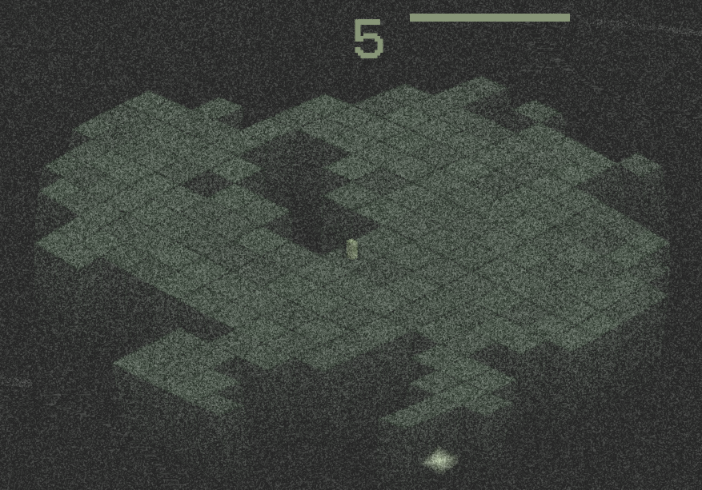

# Visual Direction

## Core look

The game is a real-time 3D scene, rendered at low resolution and pixelated by a screen-space layer on top, with a retro green monochrome palette. Models are 3D; the pixel look comes from the rendering, not from pre-drawn sprites. It is dark, grainy, and cosmic-horror oriented. The visible world should feel small and fragile against vast, dark space.

The reference for Phase 2 is a dark, near-isometric scene with heavy grain, a lit island of desaturated green terrain floating in a gray void, a tiny king at its centre, and the guiding hand as a glowing cube near the island's edge. The UI shown in that reference is not part of this game's direction.

The image is the target for Phase 2: a dark gray void with grain, a lit island of muted green tile pillars with visible seams and an irregular edge, a low diagonal camera, a tiny king, and the guiding hand as the glowing cube in the lower half. As the hand approaches, the screen gets brighter and the grain increases. Ignore the score number and bar at the top.

### Measured from the reference

These values were measured on the 877×613 image. Camera and layout follow them; brightness and grain are deliberately lighter than the image so the field stays readable in play.

| Aspect | Reference | In code |
|---|---|---|
| Camera yaw | Grid seams at ±27.5° on screen, symmetric diamonds: 45° to the grid | `Constants.PHASE2_YAW_DEG` = 45 |
| Camera tilt | Tile diamonds about 2:1 (71×37 px): about 31° | `Constants.PHASE2_TILT_DEG` = 32 |
| Perspective | Grid lines stay parallel across the frame; tiles shrink only slightly toward the top | `Constants.PHASE2_FOV_DEG` = 25 |
| Tile size | Tiles dwarf the king | `Constants.PHASE2_TILE_SIZE` = 2 m, twice a Phase 1 board tile |
| Zoom | About 12 tiles of ground fill the screen height | `Constants.PHASE2_DISTANCE` = 36 × tile size, pulled back to fit the island under the fisheye |
| Visible island | Radius of about 8 tiles around the king | `Constants.PILLAR_REVEAL_RADIUS` = 8 |
| King and hands | King tiny, guiding hand a glowing cube, the brightest element | Same models in both phases; the larger tiles and farther camera make them look small |
| Fisheye | None visible; edges stay straight | Deliberately stronger than the reference: calm fisheye 0.75, so centre tiles look about twice as big as tiles at the island edge |
| Vignette | None visible; the void is the same gray in the corners and the centre | Calm vignette 0.1 |
| Grain | Fine, about one pixel cell; spread grows with brightness (SD about 9 on the void, 17 on tiles) | Brightness-proportional grain, about half as strong at calm, see [shaders](shaders.md) |
| Colours | See [colours](colors.md) | `Palette.SCREEN_PHASE_TWO` |

## Phase contrast

### Phase 1

- Angled top-down camera looking down at the board at a tilt. The board is not rotated. The camera angle is a tunable value, not baked into the art.
- Black/dark and light chess tiles must be clearly distinct despite the green palette.
- The board, clock, and silhouettes give the scene physical context. The lower bodies of the two players show at the top of the frame; the clock stands behind the board between them, shifted toward the side of the good ending.
- No name labels on any model.
- The king colour corresponds to its chess side.
- Cutscenes use the Phase 1 camera lens from a low angle (`CameraRig.cutscene_pose`), so models keep their in-game scale and the player silhouettes tower over the board above the textbox.
- White glowing hands appear directly on the board before they act; grabs show only their shadow first.

### Phase 2

- A lower, flatter camera than Phase 1, rotated 45 degrees around the vertical axis so tiles read as diamonds, with a narrow field of view that looks almost isometric. Yaw, tilt, field of view and distance are single configurable values in `Constants`.
- Strong fisheye at all times: tiles around the king look about twice as big as tiles at the edge of the revealed island, and the bend grows further as the guiding hand closes in.
- Pillars sink into a dark mist toward their base, so holes read as dark gaps.
- Pure void behind the world: no room, player silhouettes, clock, or horizon. The void is a lifted gray, not black, so the noise stays visible on it.
- Tile pillars are twice the size of Phase 1 board tiles while the king keeps its size, so he reads as a tiny piece in a vast structure.
- Only a radius of about eight tiles of muted green pillars is visible; the irregular island edge, not a vignette, limits the view.
- The king is isolated in a small island of legibility.
- Celestial white hands provide the brightest light source.

## Hands

Hands are deliberately not rendered as ordinary human hands. They are blown-out white forms with glow, closer to a celestial presence than anatomy. Their light can affect nearby terrain. The contrast with the nearly invisible player silhouettes makes the humans feel physically present but incomprehensible.
